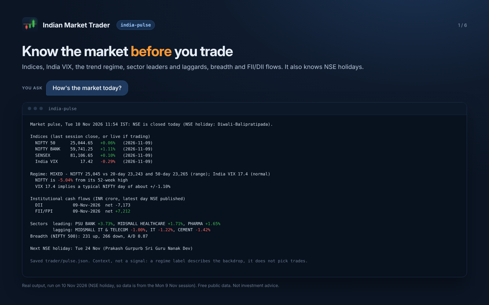
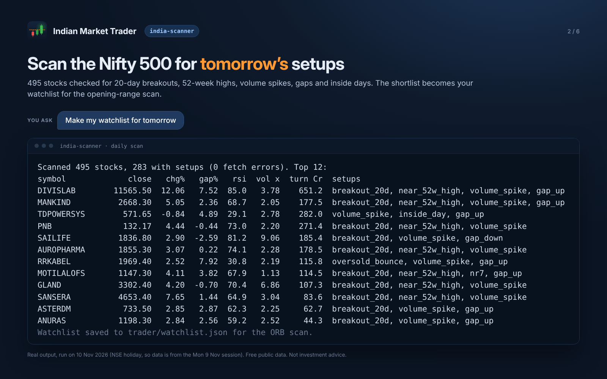
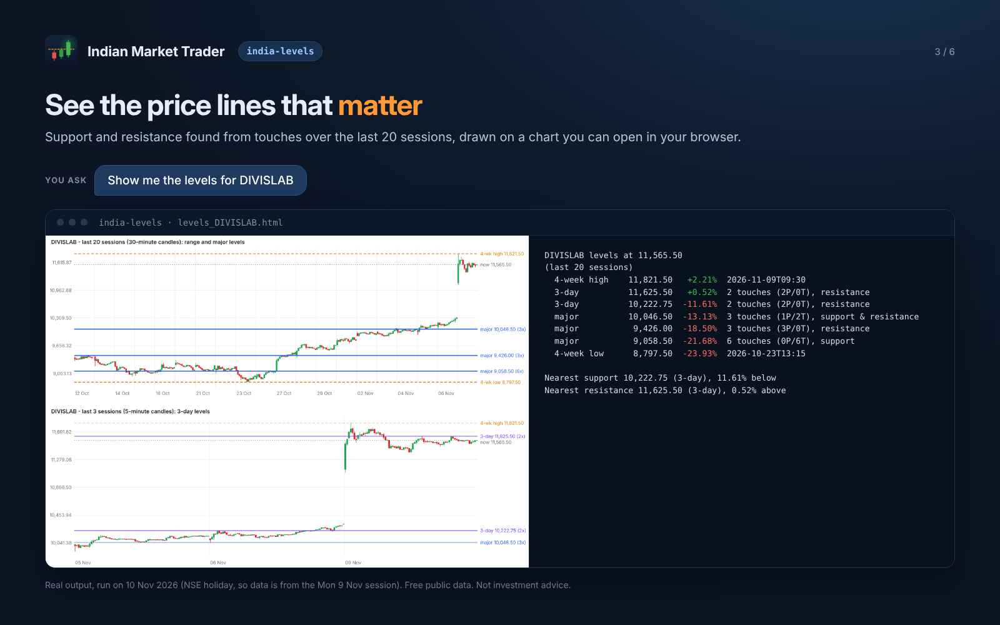
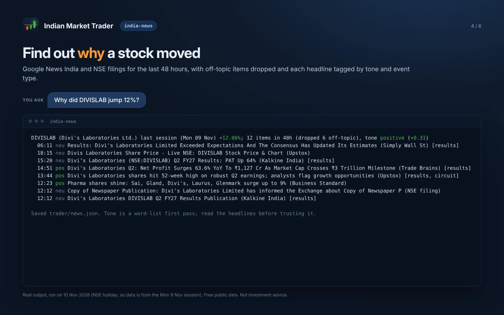
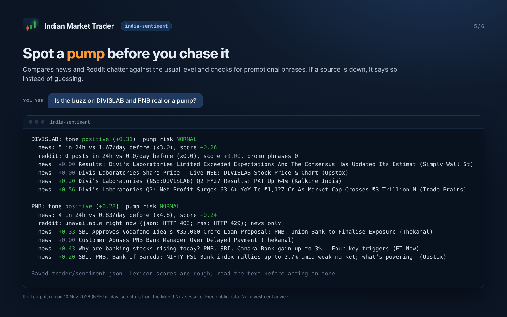
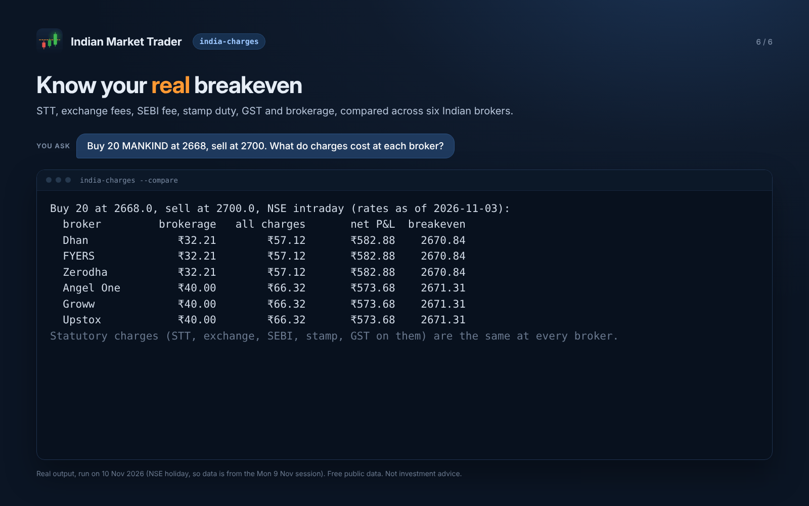

# Indian Market Trader

**Do your homework before you trade. An AI assistant for intraday trading on the NSE, built as a pack of Claude skills.**

> **This is a public showcase.** It describes the product and shows real sample output. It does **not** contain the skills, their instructions, scripts or any other part of the paid product. The official version is available through Agensi: **[Indian Market Trader on Agensi](https://www.agensi.io/skills/indian-market-trader)**.

---

## What it is

Indian Market Trader is a set of 15 Claude skills for people who day-trade stocks on India's National Stock Exchange. You ask Claude a question in plain English, Hindi or Hinglish, such as *"aaj market kaisa hai?"* or *"show me the levels for TCS"*. Claude then does the homework a careful trader would do. It checks the market mood, finds stocks with active setups, reads the news and social buzz, plans where to get in and out, counts every rupee of charges and checks the trade against your own rules. It practises with pretend money (paper trading) by default, and **it never places a real order unless you say yes to that exact order.**

## The problem it solves

Doing intraday trading carefully involves a lot of small jobs, and they all have to happen in the few minutes before you click buy:

- checking the market mood, India VIX, sector strength and FII/DII flows
- shortlisting stocks out of hundreds
- finding out *why* a stock is moving, and whether the buzz is real or a pump
- working out a stop-loss and target that make sense
- adding up STT, exchange fees, stamp duty, GST and brokerage
- sizing the position so a loss stays within your limit
- remembering your own rules when the market is moving fast

Most new traders skip some of these, and the ones they skip tend to cost them money. Indian Market Trader puts all of these jobs behind plain questions to Claude. You get the same checklist on every trade, and the answer says what it is unsure of.

## Who it is for

- **New and part-time intraday traders on the NSE** who want structure and honest numbers, not tips.
- **Experienced traders** who want a faster pre-market routine and a consistent pre-trade checklist.
- **Anyone practising with paper trading** who wants a journal that says when their record is good enough to consider real money.

It is **not** a signal service, a "get rich" bot or a replacement for a SEBI-registered adviser. See [Please read](#please-read).

## What it can do

| Skill | In plain words | You might ask |
|---|---|---|
| `india-pulse` | How is the market today? | "How's the market today?" · "aaj market kaisa hai?" |
| `india-scanner` | Which stocks have a setup today? | "Make my watchlist" · "Any breakouts?" |
| `india-levels` | Where are the important price lines? | "Show me the levels for TCS" |
| `india-news` | Why is this stock moving? | "Why did DIVISLAB jump?" |
| `india-sentiment` | What is social media saying, and is it a pump? | "Is the buzz on PNB real?" |
| `india-deals` | Are big investors buying or selling? | "Any bulk deals today?" |
| `india-entry` | Is it time to enter, or too late? | "Is it too late to enter TCS?" |
| `india-exit` | Where should the stop-loss and target go? | "Plan the stop and target" |
| `india-timemachine` | What are the odds this trade works today? | "What are the odds on this trade?" |
| `india-charges` | What will charges cost, broker by broker? | "Charges for 20 shares at 2668, sold at 2700?" |
| `india-budget` | How many shares should I buy? | "How many shares with ₹500 max loss?" |
| `india-risk` | Does this trade follow my rules? PASS or BLOCK | "Is this trade allowed?" |
| `india-broker` | Place the order, only after your yes | "Place it on paper" · "Show my positions" |
| `india-alerts` | Tell me when the price hits my stop or target | "Alert me at the stop and the target" |
| `india-journal` | How am I doing, and am I ready for real money? | "How am I doing?" |

More detail in **[docs/overview.md](docs/overview.md)**.

## How it works

1. **You ask in plain words.** Claude picks the matching skill. You don't need to learn any commands.
2. **It reads free public market data** from your own computer: prices, indices, NSE files, news headlines and Reddit posts.
3. **You get a short plain-text answer** that says what it found and how far to trust it. For example: *"Context, not a signal"* or *"Tone is a word-list first pass; read the headlines before trusting it."*
4. **Each step builds on the last.** The watchlist feeds the breakout check, the plan feeds the sizing, and the sizing feeds the risk check. By the time you decide, the whole picture is in one place.
5. **You decide.** Orders go to a paper ledger by default. A real order needs paper trading switched off, a fresh risk-check PASS, and your yes for that exact order.

| When | You ask | What happens |
|---|---|---|
| Before 9:15 | "How's the market?" | Market mood, sector leaders, holidays |
| Before 9:15 | "Make my watchlist" | A shortlist of stocks with active setups |
| After 9:30 | "Any breakouts?" | Stocks breaking their opening range |
| Picking a trade | "Plan a trade in TCS" | Levels, news, entry, stop, target, odds, shares, safety check |
| You decide | "Yes" | Order recorded (paper unless you switch it off) |
| During the trade | "Watch it" | Alerts at the stop, the target and the flat-by time |
| After 3:30 | "How did I do?" | Journal: wins, losses, charges, and readiness for real money |

## See it in action

All six screenshots are **real output**, run on 10 Nov 2026. That day was an NSE holiday, so the data comes from the Monday 9 Nov session. Not investment advice.

<table>
<tr>
<td width="50%"> <b>Scan the Nifty 500 for tomorrow's setups.</b> It checks 495 stocks for 20-day breakouts, 52-week highs, volume spikes, gaps and inside days.</td>
<td width="50%"> <b>See the price lines that matter.</b> It finds support and resistance from the last 20 sessions and draws them on a chart you can open in your browser.</td>
</tr>
<tr>
<td> <b>Find out why a stock moved.</b> It pulls the last 48 hours of news and NSE filings, drops off-topic items and tags each headline by tone and event type.</td>
<td> <b>Spot a pump before you chase it.</b> It compares news and Reddit chatter against the usual level and checks for promotional phrases. If a source is down, it says so instead of guessing.</td>
</tr>
<tr>
<td> <b>Know your real breakeven.</b> It adds up STT, exchange fees, SEBI fee, stamp duty, GST and brokerage, and compares six Indian brokers.</td>
<td> <b>Know the market before you trade.</b> It covers the indices, India VIX, trend regime, sector leaders and laggards, breadth and FII/DII flows. It also knows NSE holidays.</td>
</tr>
</table>

For a full walkthrough of one trade from breakout to journal, using made-up data, see **[examples/sample-output.md](examples/sample-output.md)**.

## Requirements and compatibility

What has been checked, as of 10 Nov 2026 (beta):

| | Status |
|---|---|
| **Claude Code** on your own computer | Supported. Checked live on a Mac. Claude Code needs a paid Claude plan. |
| **Claude desktop app, Code tab** (runs on your computer) | Supported. Market pulse checked live on a Mac. |
| **Claude chat / cloud** | Not recommended. Claude's cloud blocks the market-data sites unless you allow them, and NSE may still refuse requests. |
| **Python 3** | Required on your computer. |
| **Mac** | Checked live. |
| **Windows** | Not tested yet. |
| **ChatGPT / Codex** | Not tested. |
| **Broker connections** | Angel One and Dhan: login and read-only checks (positions, orders) verified on real accounts. Placing real orders has **not** been tested. Zerodha, Upstox, FYERS, Groww and OpenAlgo are supported in the pack but not yet tested. |

Notes:
- Market data comes from free, unofficial public sources. It can be late, change or be blocked. Check anything important in your broker's app.
- Brokerage and statutory rates are as of 3 Nov 2026. Rates change, so compare against one of your real contract notes.
- Under SEBI rules, brokers may accept API orders only from a static IP you have registered with them. Viewing your account works without one.

## Get it

The official, supported version of Indian Market Trader is sold through **Agensi**:

**→ [Indian Market Trader on Agensi](https://www.agensi.io/skills/indian-market-trader)**

Installation instructions come with your purchase. See **[docs/getting-started.md](docs/getting-started.md)** for what to expect.

## Documentation

- [Product overview](docs/overview.md)
- [Getting started](docs/getting-started.md)
- [FAQ](docs/faq.md)
- [Privacy and security](docs/privacy-and-security.md)
- [Sample output: one trade, step by step](examples/sample-output.md)
- [Changelog](CHANGELOG.md)

## Please read

- **This is not investment advice.** It is software that reads public data and does arithmetic on rules you choose. It is not a SEBI-registered investment adviser or research analyst.
- **Most intraday traders lose money.** SEBI found that about 7 in 10 individual intraday traders lost money in FY2022-23. Practise with pretend money for weeks first, and let the journal judge your record.
- **The odds are a simulation, not a promise.** Results days, circuits and big news can move a stock in ways its past never did.
- **A stop-loss can slip.** In a fast market or a circuit, it can fill far from your price, or not at all.
- **Social media buzz is a warning, not a tip.**
- **Taxes:** intraday profit is usually taxed as speculative business income. Ask a tax professional.

## About this repository

This repository is a marketing and documentation showcase. It does not include the skills, their instructions, source code, templates or configuration, and you cannot install the product from it.

© 2026 Ishan Savio Kerketta. All rights reserved. See [LICENSE](LICENSE). Broker, exchange and publication names appear only to describe compatibility and data sources. They belong to their owners and do not imply endorsement.
